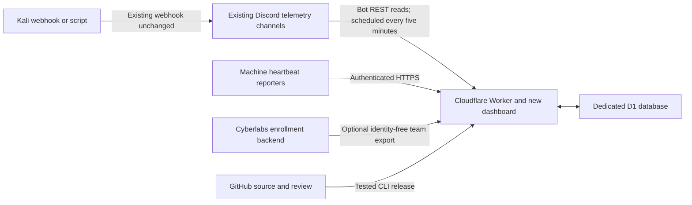

> **Standard cost profile (November 4 update):** dashboard and source polling every five minutes; combined snapshots shared-cache for 60 seconds; heartbeat send/write interval five minutes; machine degradation after 12 minutes and offline after 20; pipeline stale after 15 minutes. Source-to-screen visibility can take about 11 minutes including collection, cache and browser timing. Faster updates require an approved funded deployment. This supersedes earlier live-refresh timings.

# Claw & Order on Cloudflare

**November 8 — Nestler migration staged, not cut over:** the website/API Worker and a verified D1 restore now exist in Nestler's account. Public routing and collection are disabled there. Initial `workers.dev` registration failed with HTTP 403; the dashboard also displayed **No access / Authentication error**. Nestler must complete the account's initial Workers address setup from his owner login. The original production site remains unchanged. See [migration status and cutover steps](NESTLER-MIGRATION-STATUS.md). Deployment still defaults to the original account until the new public endpoint passes verification; select `CLAW_DEPLOY_TARGET=nestler` explicitly for staging.

**November 5 — Hermes and roster update:** read [Hermes, Discord access and team readiness](HERMES-DISCORD-ROSTER-READINESS.md). Hermes is selected; the existing Discord server and incoming webhooks stay. Native Hermes bot replies do not carry the required posting webhook identity and are rejected as telemetry. Verify the installed publisher's actual format before connection. Access to additional private channels must be authorized and tested; adding telemetry channels also changes collection latency. Reconcile Discord-only students before approved imports, and keep faculty-approved red-team coverage separate from enrollment/scoring authorization.

## Purpose and current boundary

Cloudflare replaces the Heroku **React dashboard, telemetry API, persistent event database, and Discord reader**. The topology gallery and its existing Ultra-PC cyberpunk visual identity are retained. The Python scoring/enrollment application, Excel review workflow, Discord role assignment worker, and Hermes instructions remain a separate Cyberlabs service. This migration does not install that service or create student roles.

The source is `des-work/c3claw`, branch `feature/team-topology-gallery`, PR #1. `cloudflare.config.ts` is the deployment configuration. The normal Express/PostgreSQL implementation is retained for local compatibility and recovery; it is not run by the Cloudflare Worker.



The owner confirmed the existing Kali-to-Discord connection is a webhook/script. Its deployed script and payload have not been inspected. The reader accepts `[OCRT] team_id | tool | target | result | details`. Confirm a real Kali message matches that contract before declaring the feed live. Webhooks send messages to Discord; **a webhook URL is not a reader bot credential**.

## Resources and clean start

| Resource | Configuration |
| --- | --- |
| Worker | `claw-and-order`, on the account already used for the other Cloudflare projects |
| D1 | `claw-and-order`, database ID `1b405da4-cdc6-4087-8194-295f22f8b74a` |
| Static application | React/Vite output served by Workers Static Assets; API calls use the same origin |
| Schedule | Every five minutes; two channels per run, rotating oldest-attempted first |
| Collection cutover | `2026-11-04T21:12:10.000Z` (November 4, 1:12:10 p.m. Pacific) |
| Observability | Structured logs, sampled traces, source health, backlog and rejection counters |

This is a new, empty database. No Heroku rows, old team summaries, or old Discord history are copied into the gallery. A new Discord checkpoint starts at the explicit cutover time, so setup delays do not silently drop messages posted after cutover. Direct events older than cutover return 422. A backend export containing older events is left unacknowledged for administrator review, rather than repopulating the dashboard.

The Heroku account was reported deleted for payment issues. No Heroku resources have been deleted or changed by this migration. The private local snapshot contains only 100 recent events and 77 summaries; **it is not a complete PostgreSQL backup**. Full historical recovery still requires a valid older backup or assistance from the prior host. The new Cloudflare site can operate independently of that recovery.

## Finish the existing Discord connection

The owner can access the Discord Developer Portal. Use the existing application/bot intended to **read telemetry**, and keep the same server and incoming webhooks. Do not reset a shared bot token without coordinating with other services using it.

In Cloudflare, open **Workers & Pages → claw-and-order → Settings → Variables and Secrets**. Add these as encrypted secrets and deploy the settings:

| Name | Exact value needed | Success check |
| --- | --- | --- |
| `DISCORD_BOT_TOKEN` | The existing reader bot token from the Discord Developer Portal | Bot can authenticate; no 401 in health/logs |
| `ALLOWED_CHANNELS` | Comma separated IDs of the intended class telemetry text channels | Every listed channel is covered by the source policy |
| `DISCORD_SOURCE_POLICY_JSON` | JSON matching `config/discord-sources.example.json`: each exact channel ID + webhook **ID** mapped to its permitted team IDs | A mapped producer is accepted only for its own teams |

Only webhook **IDs** belong in the source policy. Do not paste full webhook URLs or tokens into that policy, GitHub, reports, or chat. Enable Discord Developer Mode to copy channel IDs. A webhook ID is the numeric component after `/webhooks/` in its existing URL; keep the remaining token private. Team IDs must exactly match the reviewed roster and machine inventory.

Bot permissions: **View Channel** and **Read Message History** on each allowlisted channel. Enable **Message Content Intent** for this application in the Developer Portal. The reader checks effective server/role/member channel permissions before polling. Administrator or Manage Roles permission is not needed for this reader. The separate enrollment bot needs its own reviewed role permissions and hierarchy as documented in the enrollment handoff.

`EVENT_API_KEY` is a separate, newly generated Worker secret for HTTPS event and machine writes. It is not a Discord token. It is provisioned privately during deployment; never embed it in Vite settings, browser code, screenshots, or a public document.

Optional settings:

| Name | When to set it |
| --- | --- |
| `TOPOLOGY_JSON` | Reviewed class/team/machine inventory using `config/topology.example.json`. Machines remain unknown until a heartbeat arrives. |
| `BACKEND_EXPORT_URL`, `BACKEND_EXPORT_SECRET` | The Cyberlabs HTTPS origin and restricted `EVENT_EXPORT_SECRET`. Both are required together. This also enables identity-free enrollment snapshots. |
| `TELEMETRY_SOURCE` | Default `discord`. Change the source in `cloudflare.config.ts` to `backend` only if the scoring exporter is the chosen event feed. Never ingest the same logical event through both paths. |

The Worker does not accept student emails, student IDs, or registration codes in its enrollment snapshot. Excel files go through the reviewed Cyberlabs enrollment process. Only team/class/term IDs, display names, member counts, and optional CIDRs reach this gallery. Review the backend's active term before connecting it; an old enrollment snapshot could otherwise reintroduce prior teams.

## Release procedure

Use Node.js **22.23 or newer in the supported CLI engine ranges**, and the committed lockfile. The CLI and Vite plugin are pinned beta versions; upgrade them deliberately and rerun runtime tests.

```sh
npm ci
npm test
npm run lint
npm run build
npm run cloudflare:build
npm run test:cloudflare
```

Sign in with `npx cf auth login` for ongoing administration. The migration used the already authorized local Cloudflare session without printing its token. Set `CLOUDFLARE_ACCOUNT_ID` if operating outside the configured project. An API token used for CI should be restricted to the intended account and necessary Worker/D1 operations.

Preview and apply migrations to this dedicated database:

```sh
npx cf d1 migrations apply 1b405da4-cdc6-4087-8194-295f22f8b74a --dir cloudflare/migrations --dry-run
npx cf d1 migrations apply 1b405da4-cdc6-4087-8194-295f22f8b74a --dir cloudflare/migrations
```

The dry-run validates arguments only; it does not validate SQL against the remote database. SQL and recovery behavior are exercised by `npm run test:cloudflare` before remote application. After application, confirm the migration is recorded and all required tables/triggers exist.

Set `CLAW_RELEASE_ID` to the reviewed Git commit SHA, then build/deploy:

```sh
export CLAW_RELEASE_ID="REVIEWED_COMMIT_SHA"
npx cf deploy --mode cloudflare --dry-run
npx cf deploy --mode cloudflare
```

For initial secret provisioning, the supported command is `npx cf deploy --mode cloudflare --secrets-file /private/path/to/secrets.json`. Protect that JSON file and use a file outside source control. Never pass a secret value in a shell command argument. Preserve existing production secrets on subsequent releases and confirm secret **names/presence** afterward.

GitHub hosts the source and runs the existing functional CI. The additional Worker runtime gate needs Node 22; `docs/ci-cloudflare-runtime.patch` is supplied for a repository owner because the current GitHub authorization lacks workflow write scope. **Automatic production deployment from GitHub is not configured by this CLI deployment.** Use the reviewed CLI release until a restricted deployment integration is deliberately configured. Do not assume pushing or merging a PR deploys the new site. Review the old Heroku GitHub integration before merging: its configuration is inaccessible.

## Reliability and limits

- Accepted events and team summary counters update in one SQLite transaction through triggers. Repeated source IDs cannot increment counts twice. Conflicting payloads for an existing source ID abort instead of overwriting history.
- Discord pages are frozen at a head and staged durably while scanning backward. The next invocation resumes the scan; completed scans import oldest first in bounded batches. Events, rejection receipts, checkpoint advance, and inbox deletion commit atomically.
- Missing permissions, unreadable content, rate limits, or storage failures preserve recovery checkpoints. Global 429 cooldowns survive restarts. Do not delete checkpoints to hide an error.
- Backend events are stored before export acknowledgement. Failed acknowledgements retry against deduplication. Invalid enrollment payloads or class conflicts retain the last good snapshot.
- The summary endpoint reads small indexed summary/machine tables rather than scanning historical events. The event endpoint is capped at 100 rows. Request/response sizes and batch work are bounded.
- Machine status is independent of Discord activity. No heartbeat means unknown; an online heartbeat degrades after 12 minutes and becomes offline after 20 minutes.

Default capacity is two telemetry channels per five-minute scheduled run. Put multiple teams' explicitly mapped webhooks in the appropriate class channel. Additional channels rotate fairly but can increase latency; health flags stale channels after 15 minutes. Sustained backlog requires a capacity change and a new load rehearsal, not resetting cursors. Each run stages up to 100 messages and imports up to 100 queued messages per selected channel.

No paid subscription or plan upgrade was requested by the migration. The current token cannot read billing subscriptions, so the active plan is **unverified**. Workers Free currently allows 100,000 requests/day; D1 Free includes 5 million rows read and 100,000 rows written/day, with smaller database limits. These are account totals shared with other projects. The standard profile uses one combined dashboard request every five minutes: about 96 API requests per visible dashboard during an eight-hour day. Ninety machine reporters configured to send every five minutes use about 25,920 requests/day. Heartbeat writes faster than that are rejected with 429/Retry-After, but unwanted HTTP attempts still count, so configure the producers correctly. See [COST-CONTROLS.md](COST-CONTROLS.md) for assumptions, cost estimates and sponsorship policy. Free quota exhaustion returns errors; it must not be mistaken for current empty data.

Official references: [Workers pricing](https://developers.cloudflare.com/workers/platform/pricing/), [D1 pricing](https://developers.cloudflare.com/d1/platform/pricing/), [D1 limits](https://developers.cloudflare.com/d1/platform/limits/), [D1 recovery](https://developers.cloudflare.com/d1/reference/time-travel/), [Discord channel reads](https://docs.discord.com/developers/resources/message#get-channel-messages).

## Acceptance and failure plan

| Gate | Success outcome | Failure and fallback |
| --- | --- | --- |
| Hosting and clean start | Root loads the topology gallery; `/api/status` and `/api/events` are empty before configuration; health reports `persistence=d1` and the reviewed release SHA | Keep new feeds disconnected; repair the Worker/D1 binding or roll back its code version |
| Missing configuration | `/api/health` returns 503 with explicit problems while Discord is unconfigured | Expected pending state; configure the existing bot/source policy rather than claiming live readiness |
| Real Discord pilot | One authorized Kali message per class appears once with its original posting time within 12 minutes of an idle scheduled reader under the standard profile | Inspect format, intent, effective permissions and source mappings; checkpoint remains recoverable; re-post corrected quarantined messages only after human review |
| Permission isolation | Ordinary-user, wrong-webhook and cross-team test messages are rejected and counted without modifying another team | Disable the reader while correcting the source policy; inspect private rejection records |
| Restart/backlog | A 250+ message staged test drains without missing/duplicate events across restarts; rejected messages have receipts | Keep source history and staging; repair errors and resume without advancing the checkpoint manually |
| Machine reports | Authenticated heartbeat changes the correct machine; invalid/unauthorized reports fail; stale state degrades/offlines correctly | Leave unknown/offline indicators; fix the actual probe/report path |
| Enrollment integration | Current-term reviewed roster teams/classes appear with counts, without PII; transfer/withdrawal follows the existing approval/audit process | Preserve last good snapshot and reconcile the Cyberlabs backend before reconnecting |
| Load and quotas | At 2× expected peak plus a 5× burst, p95 API <1 second, no quota errors, source/dashboard totals match after catch-up, normal idle-source visibility ≤12 minutes under the standard profile | Reduce producers/viewers temporarily; review plan, batch limits, channel fan-out and polling; repeat staging test |
| Recovery | D1 export checksum verified and restore rehearsed in a separate database; version rollback tested | Keep the working database; restore to a new database and rebind only after totals/inventory match |

Real Discord, roster/role automation, machine producer and production-sized load acceptance remain operator gates until the actual credentials, active roster, and inventory are available. Local mocks are not evidence that a live Kali machine reached Discord.

For future semesters: export D1 and verify recovery first; create a new database and reviewed cutover; connect current-term inventory/export; retain the previous database privately. Code rollback does not roll back D1 data. If a feed is unsafe, remove its token/export credentials and deploy that settings change; existing rows remain available. Preserve Discord history, inbox and rejection receipts for audit. Consult an administrator before restoring a checkpoint because this can intentionally re-read old data.
